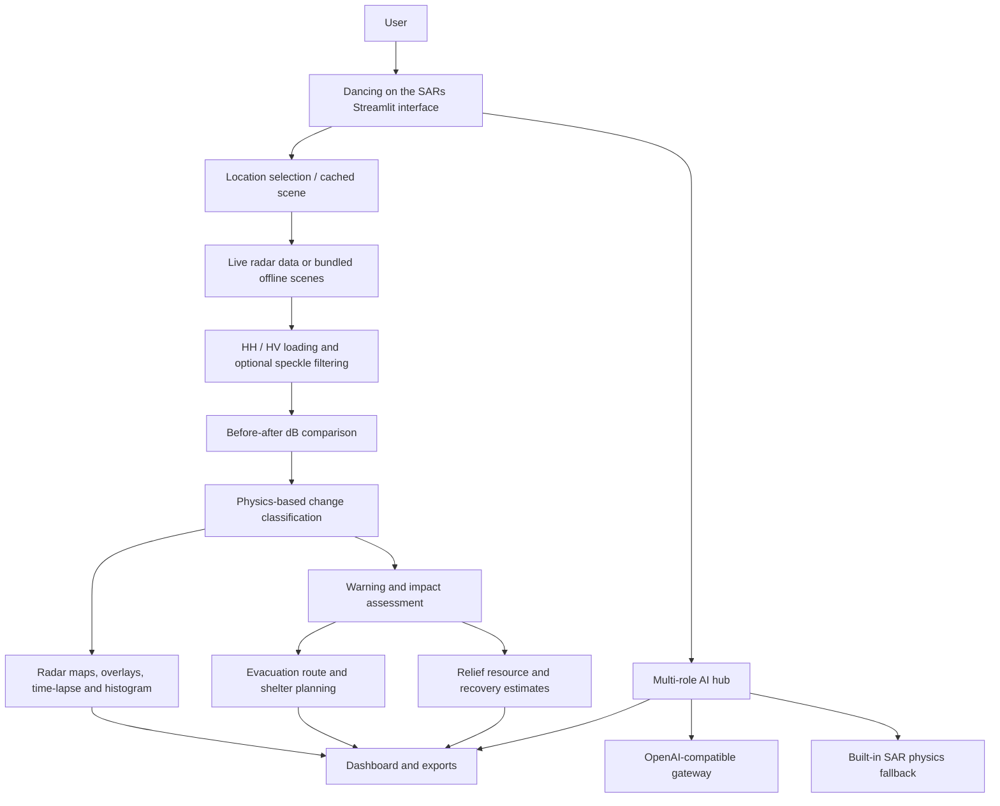

# Dancing on the SARs — Dancing on the SARs

**Team:** Orbital Mindss  
**Event:** NASA Space Apps Challenge 2026  
**Application:** Dancing on the SARs  
**Tagline:** L-band radar change detection and a multi-model AI hub for floods, forests and relief — live or offline.

> **Live application:** Not provided in the presentation. Add the verified deployment URL when available.  
> **Demo video:** Not provided in the presentation. Add a link if one is available.

---

## 1. Project Title & Problem Statement

### Project title

**Dancing on the SARs — Dancing on the SARs**

### Problem addressed

Floods, storm impacts, deforestation and urban change need to be detected and interpreted even when optical satellite imagery is obstructed by clouds or when observations are needed at night. Decision-makers also need to turn satellite observations into practical information for warnings, evacuation planning, relief-resource estimates and recovery monitoring.

### Project summary

Dancing on the SARs is a Streamlit application that analyses L-band Synthetic Aperture Radar (SAR) change between before-and-after scenes. It uses the HH and HV radar channels and a set of physics-based change rules to identify patterns associated with new flood water, receded flood water, canopy loss, regrowth and built-up double-bounce change.

The application combines radar analysis with crisis-planning modules and a multi-role AI hub. It is designed to work with live data sources when available and with five bundled radar scenes and cached values in offline mode.

### Main objectives

- Detect and visualise changes in radar scenes over time.
- Support flood and forest-change interpretation using HH and HV backscatter.
- Present early-warning indicators, impact assessment and evacuation-route planning information.
- Estimate relief requirements and show recovery-planning indicators.
- Provide AI-assisted interpretation and report/map exports, with a built-in physics engine available offline.

---

## 2. Team Details

**Team name:** Orbital Mindss

| # | Team member |
|---:|---|
| 1 | Atharva Chandewar |
| 2 | Radha Bangale |
| 3 | Anushri Borade |
| 4 | Manthan Kale |
| 5 | Dipti Kushwaha |

The presentation does not specify each member's institution, GitHub username or individual engineering/design role. Add those details only after confirming them with the team.

| Team member | Institution | GitHub username | Engineering / design role |
|---|---|---|---|
| Atharva Chandewar | _Government Polytechnic Nagpur_ | _aadichandewar_ | _Application Design_ |
| Radha Bangale | _Government Polytechnic Nagpur_ | _radhabangale_hash_ | _Frontend_ |
| Anushri Borade | _Government Polytechnic Nagpur_ | _boradea17_ | _Backend_ |
| Manthan Kale | _Government Polytechnic Nagpur_ | _Manthandefine_ | _Backend_ |
| Dipti Kushwaha | _Government Polytechnic Nagpur_ | _DK007_ | _Researcher_ |

---

## 3. Solution Overview & Architecture

### 3.1 How Dancing on the SARs works

The workflow presented by the team is:

1. **Pick a place** — search for a location, use a quick-pick option or load a cached scene.
2. **Load scenes** — load before-and-after radar scenes for HH and HV channels.
3. **Compare** — optionally apply a speckle filter, then calculate the dB difference.
4. **Classify** — inspect dark, stable and bright changes, along with the six physics-based classes.
5. **Decide** — review warnings, routes, relief information and an AI-generated report.

### 3.2 Radar channels and change rules

The project uses L-band radar. The presentation describes the channels as follows:

- **HH:** used to interpret reflections associated with water and walls/structures.
- **HV:** used to interpret reflections associated with leaves and branches.
- **Cloud and night capability:** radar observations can remain useful when clouds obstruct optical views and during nighttime.

The following thresholds are documented in the presentation as the rules used by `change_types()` in `app.py`:

| App classification | Before → after radar rule |
|---|---|
| Stable surface | Does not meet any of the other listed rules |
| Deforestation / canopy loss | HV change ≤ −3 dB |
| Regrowth | HV change ≥ +3 dB |
| New flood water | Current HH < −16.5 dB; previous HH ≥ −16.5 dB; change ≤ −2.8 dB |
| Flood receded | Previous HH < −16.5 dB; current HH ≥ −14 dB; change ≥ +2.8 dB |
| Built-up / double-bounce | HH change ≥ +3 dB and HV change < 1.8 dB |

### 3.3 Application modules

The presentation identifies nine modules:

| # | Module | Function described in the presentation |
|---:|---|---|
| 1 | Radar & change map | Time-lapse, overlay, six change classes and histogram |
| 2 | Early warning | Rain, discharge, soil, EONET information and a 72-hour matrix |
| 3 | Impact assessment | Quadrant-based triage and asset exposure |
| 4 | Evacuation routes | Three routes, shelters and corridor map |
| 5 | Community reports | Offline field form checked against SAR |
| 6 | Deforestation | Canopy loss, biomass, CO₂ and regrowth |
| 7 | Relief resources | Boats, water, meals, kits and staging sites |
| 8 | Damage & recovery | Recovery index and four-phase timeline |
| 9 | AI hub & export | AI chat, Markdown report export and PNG evacuation-map export |

The impact tab divides a scene into NW, NE, SW and SE quadrants. The presentation lists severity levels as **CRITICAL at 22% or more** and **ELEVATED at 10% or more**.

### 3.4 Data sources and offline capability

**Live sources listed in the presentation**

- ALOS-2 PALSAR via Microsoft Planetary Computer.
- NISAR via NASA Alaska Satellite Facility (ASF); an Earthdata login is required for live NISAR access.
- Sentinel-1.
- NASA EONET.
- Open-Meteo.
- GloFAS.

The presentation states that PALSAR is used when live NISAR access is not available.

**Offline and field mode**

- Five bundled radar scenes.
- Cached telemetry.
- Local, built-in SAR physics engine.
- Offline field reports.
- Mobile Progressive Web App (PWA) mode.

The presentation notes that cached offline values are fixed defaults. Live rain, discharge and EONET information comes from Open-Meteo, GloFAS and NASA EONET. The offline mode is enabled using the **Offline Field and Mobile Mode** toggle in the sidebar.

### 3.5 Bundled radar scenes

The presentation identifies these five offline scenes and their example change summaries:

| Scene | Period | Channel | Results shown in the presentation |
|---|---|---|---|
| Kosi River | 2020–2024 | HH | 35.6% new water; 7.0% built-up |
| Assam Brahmaputra | 2021–2025 | HH | 35.6% new water; 6.9% built-up |
| Sundarbans | 2019–2024 | HV | 53.8% new water; 8.0% canopy loss |
| Rondonia, Brazil | 2017–2024 | HV | 45.9% canopy loss; 53.7% stable |
| Dubai coast | 2018–2024 | HH | 30.9% built-up; 69.1% stable |

These are the presentation's example outputs from the bundled scenes, calculated using the application's change-classification rules. They should not be interpreted as independently verified ground-survey measurements.

### 3.6 Early warning and evacuation planning

The presentation describes these alert thresholds:

| Alert level | Condition shown in the presentation |
|---|---|
| CRITICAL (RED) | Rain above 120 mm or discharge above 140% of mean |
| ELEVATED (ORANGE) | Rain above 50 mm or discharge above 110% |

The example 72-hour action matrix is:

| Time window | Example risk | Example action |
|---|---|---|
| 0–12 hours | HIGH | Sirens in low wards; halt ferries |
| 12–36 hours | CRITICAL PEAK | Complete evacuation on ALPHA and BRAVO |
| 36–72 hours | RECEDING | Water purification and medical camps |

The presentation also shows a cell-broadcast preview and siren/SMS dispatch button. These are interface/workflow features; the presentation says that connecting real SMS sirens is future work.

Example route templates shown:

| Route | Distance | Elevation gain | Description |
|---|---:|---:|---|
| ALPHA | 6.4 km | +38 m | Ridge highway |
| BRAVO | 8.1 km | +52 m | Elevated bund |
| CHARLIE | 4.8 km | +29 m | Boat / helipad |

**Important limitation:** The presentation explicitly says route distances are templates in the code. They must not be treated as verified, real-world safe evacuation directions.

### 3.7 Impact, relief and recovery calculations

The presentation describes the following planning formulas:

- Exposed people = flooded area (km²) × 420 + bright area (km²) × 180.
- Displaced people = 38% of exposed people.
- Water estimate = 15 litres per displaced person.
- Meals estimate = 3 per displaced person per day.
- Medical kits = 1 per 25 displaced people.
- Boats = flooded area (km²) ÷ 1.8.
- Asset exposure estimate = 85 structures and 62.5 hectares of cropland per flooded km².
- Biomass estimate = 145 tonnes per hectare of canopy loss.
- CO₂-equivalent estimate = biomass × 1.83.

The presentation explicitly states that these are **fixed planning formulas, not survey data**. The recovery timeline uses fixed illustrative values. The example timeline is:

**T+0 impact → T+15 dewatering → T+45 repair → T+120 restoration**

Example figures shown for the Kosi scene include 4,386 people exposed, 1,667 displaced, 6 boats, 3 SAR teams, 25,005 litres of water, 5,001 meals per day, 67 medical kits and 334 tents. The presentation also shows a Rondonia example with 12.08 km² canopy loss, 1,208 hectares, 175,160 tonnes of biomass and 320,543 tCO₂e. These are application-generated estimates based on the formulas above, not field-verified counts.

### 3.8 Multi-model AI hub

The presentation describes the following task-specific AI roles:

| AI role | Model / engine named in the presentation | Intended task |
|---|---|---|
| SAR Vision AI | Claude-3.7-Sonnet + SAR-Vision-Physics | HH/HV change-map interpretation |
| Crisis Triage AI | Gemini-2.5-Pro Crisis Analytics | Impact, exposure and early warning |
| Evac Route AI | GeoGraph-Evac-LLM + Topographic Router | Corridors and high-ground shelters |
| Eco Biomass AI | BioSAR-Llama-3.3-70B | Canopy loss and carbon |
| Omni Chat AI | GPT-4o, Claude and DeepSeek ensemble | Field and scientific Q&A |
| Offline engine | Built-in SAR physics engine | Answers without internet |

The presentation says the roles are defined in `AI_MODEL_REGISTRY`, requests go through one free OpenAI-compatible gateway, and the built-in physics engine is used as a fallback and in offline mode. A badge identifies which engine answered. The application can export a Markdown report (`.md`) and a map (`.png`).

> Model names and routing above reproduce the project presentation. Actual availability, provider configuration, credentials, and successful responses depend on the deployed application configuration and should be checked before the final submission.

### 3.9 Architecture overview

The following is a high-level diagram based on the workflow and components described in the presentation. It is a conceptual overview, not a code-generated dependency diagram.



### 3.10 Technology and services identified

| Area | Technology / service named in the presentation |
|---|---|
| Application interface | Streamlit |
| Main application language | Python (indicated by `app.py` and the Python-based launcher) |
| Radar data | ALOS-2 PALSAR, NISAR, Sentinel-1 |
| Geospatial/data platforms | Microsoft Planetary Computer, NASA ASF |
| Event/weather/hydrology data | NASA EONET, Open-Meteo, GloFAS |
| AI integration | OpenAI-compatible gateway and the model roles listed above |
| Offline analysis | Built-in SAR physics engine |
| Mobile delivery | Progressive Web App (PWA) |
| Version control / project submission | Git and GitHub (per the event submission requirements) |

The presentation does not provide exact package versions, a complete dependency list, hosting provider, or a detailed database/backend specification. Refer to the repository's `requirements.txt` and source code for the exact software dependencies.

---

## 4. Live Demo & Screenshots

### Demo links

- **Live application URL:** _[Add only after deployment has been tested and the public URL is confirmed](https://manthandefine-dancing-with-the-sars-dancing-on-sarsapp-00kezk.streamlit.app/)._
- **Demo video:** _Add a video link if available._
- **GitHub repository:** _[Add the final public repository URL.](https://github.com/Manthandefine/dancing-with-the-sars)_

The presentation shows a local prototype at `localhost:8501`. This is a local development address, not a public live-demo URL.

### Screenshots to include

Add genuine screenshots captured from the running application. Suggested screenshots, matching the screens described in the presentation:

1. Main dashboard and location selection.
2. Before-and-after HH/HV radar scenes.
3. Anomaly overlay and six-class change map.
4. Change statistics and histogram.
5. Early-warning dashboard and 72-hour matrix.
6. Impact assessment and quadrant triage.
7. Evacuation routes and shelter map.
8. Deforestation and biomass analysis.
9. Relief resources and recovery dashboard.
10. AI hub and export options.

Store the image files in a `screenshots/` folder in the repository, then embed them here using their actual filenames, for example:

```markdown


```

Do not leave example image links in the final repository unless those image files actually exist.

---

## 5. Installation & Setup Guide

### Prerequisites

- A computer running Windows, macOS or Linux.
- Python installed.
- Git installed to clone the repository.
- Internet access to install dependencies and use live data or online AI services.
- For live NISAR access, the presentation specifies an Earthdata login.
- A compatible browser to open the Streamlit interface.

The project materials supplied for this README identify `app.py`, `requirements.txt` and `run_windows.bat`. The Windows launcher uses a Python virtual environment and installs dependencies from `requirements.txt`.

### Clone the repository

Replace the placeholder with the team's actual public GitHub repository URL:

```bash
git clone <YOUR_PUBLIC_GITHUB_REPOSITORY_URL>
cd <YOUR_PROJECT_DIRECTORY>
```

### Windows: use the supplied launcher

Ensure that `app.py`, `requirements.txt` and `run_windows.bat` are in the project directory.

1. Open the project directory in File Explorer.
2. Double-click `run_windows.bat`, or open Command Prompt in that directory.
3. Run:

```cmd
run_windows.bat
```

The launcher prepares/activates the project's `.venv`, installs the packages listed in `requirements.txt`, and starts the Streamlit application.

### Manual setup

**Windows (Python 3.12):**

```cmd
py -3.12 -m venv .venv
.venv\Scripts\activate
python -m pip install --upgrade pip
python -m pip install -r requirements.txt
python -m streamlit run app.py
```

**macOS / Linux (Python 3.12):**

```bash
python3.12 -m venv .venv
source .venv/bin/activate
python -m pip install --upgrade pip
python -m pip install -r requirements.txt
python -m streamlit run app.py
```

When Streamlit starts, open the **Local URL** printed in the terminal. The presentation's local prototype used port `8501`; the usual local address is `http://localhost:8501`.

### Offline mode

Use the application's **Offline Field and Mobile Mode** toggle in the sidebar. In offline mode, the presentation describes five bundled radar scenes, cached telemetry, offline field reports and the built-in SAR physics engine. Cached values are fixed defaults and are not live observations.

### Troubleshooting

- **`ModuleNotFoundError`:** Activate the project's `.venv`, then run `python -m pip install -r requirements.txt`.
- **Streamlit package/import error:** With `.venv` activated, reinstall the declared dependencies using `python -m pip install --no-cache-dir --force-reinstall -r requirements.txt`.
- **`app.py` not found:** Run the command from the directory that contains `app.py`.
- **Browser does not open automatically:** Open the Local URL printed in the terminal manually.
- **Live NISAR data does not load:** Check the Earthdata login requirement described in the project presentation; use the available PALSAR source or offline scene if appropriate.

Do not commit the `.venv/` directory, local secrets, access tokens or private credentials to GitHub.

---

## 6. AI Usage Disclosure

The project presentation describes AI-assisted components in the multi-model AI hub and names these model roles:

- SAR Vision AI: Claude-3.7-Sonnet + SAR-Vision-Physics.
- Crisis Triage AI: Gemini-2.5-Pro Crisis Analytics.
- Evac Route AI: GeoGraph-Evac-LLM + Topographic Router.
- Eco Biomass AI: BioSAR-Llama-3.3-70B.
- Omni Chat AI: GPT-4o, Claude and DeepSeek ensemble.
- Offline fallback: built-in SAR physics engine.

The presentation also states that the AI roles are registered in `AI_MODEL_REGISTRY` and requests are routed through a free OpenAI-compatible gateway, with the built-in physics engine used as fallback and for offline operation.

**This section must be completed by the team before submission:** the presentation does not identify which external generative AI tools were used to write or debug the source code, create design assets, or prepare documentation. Do not treat the application's AI features as a complete disclosure of development-time AI assistance.

| AI tool used during development | Exact files / components assisted | Type of assistance | Team review, modification and testing |
|---|---|---|---|
| _Confirm with the team_ | _List exact files/modules_ | _Brainstorming, code assistance, debugging, design, documentation, etc._ | _Describe what the team independently reviewed, changed and tested_ |

Disclose all development-time AI assistance accurately, including assistance used for code, copy and design assets. Ensure Git commits are authored by the registered human team members, in accordance with the event handbook.

---

## Limitations & Important Interpretation Notes

The following qualifications are stated in the project presentation and are important when interpreting the prototype:

- The relief, population, displacement, water, meal, medical-kit, boat, asset, biomass and CO₂ figures are estimates generated using fixed planning formulas; they are not survey data.
- The recovery timeline percentages are fixed illustrative values.
- Offline cached telemetry values are fixed defaults, not live measurements.
- Evacuation route distances are templates in the code and are not verified real-world safe routes.
- The presentation identifies real SMS/siren integration as future work; a displayed dispatch control should not be represented as proof that live emergency messages are connected.
- Live NISAR access requires an Earthdata login, according to the presentation.
- The five bundled-scene percentages and prototype dashboard values are application outputs, not independently verified ground truth.

Dancing on the SARs is a prototype decision-support tool. Its maps, alerts, route templates and resource estimates should not be treated as a substitute for official emergency-management instructions, field validation or expert assessment.

---

## Acknowledgements & Data Sources

The project presentation identifies the following data sources and platforms:

- ALOS-2 PALSAR via Microsoft Planetary Computer.
- NISAR via NASA Alaska Satellite Facility (ASF).
- Sentinel-1.
- NASA Earth Observatory Natural Event Tracker (EONET).
- Open-Meteo.
- Global Flood Awareness System (GloFAS).

Add the exact dataset/product citations, API documentation links, access dates and any required attribution/licence notices used by the implementation before publishing the repository. Also acknowledge software libraries and contributors actually used.

## License

_Add the license selected by the team. Do not claim that the project is open-source under a particular license until a license has been chosen and a corresponding `LICENSE` file has been added._

---

## Final repository checklist

Before making the repository public and submitting it, verify all of the following:

- [ ] `README.md` is in the repository root.
- [ ] `app.py` is present and is the actual application entry point.
- [ ] `requirements.txt` lists the dependencies needed for a clean installation.
- [ ] `run_windows.bat` is included and tested on a clean Windows setup.
- [ ] Any additional source modules, configuration files and required assets are included.
- [ ] No `.venv/`, passwords, API keys, tokens or other secrets are committed.
- [ ] Team member names, institutions, GitHub usernames and roles are confirmed.
- [ ] Live demo URL is public and tested, or clearly marked as not deployed.
- [ ] Screenshots and demo video links point to files that actually exist.
- [ ] Dataset, API, library and asset attributions are included.
- [ ] AI Usage Disclosure is complete and accurate.
- [ ] Each registered member has genuine commits from their own GitHub account.
- [ ] The team has tested the setup instructions from a fresh clone.
